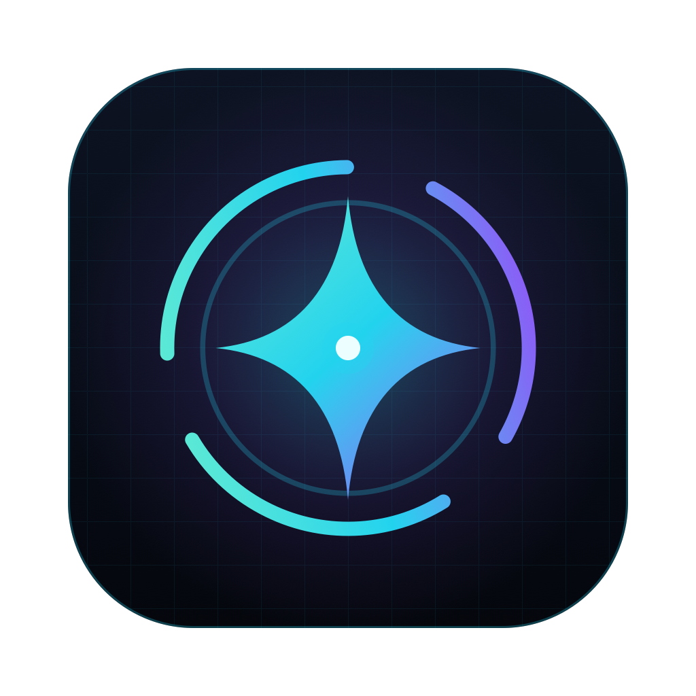

<p align="center"></p>

# Spark

Copilote visuel multimodal : une surcouche transparente qui voit ton écran et
dialogue avec toi, par texte ou à la voix, grâce à **A.R.I.A** (Augmented
Reality & Intelligence Agent).

Stack : [Wails v2](https://wails.io) (Go + React/TypeScript), Tailwind CSS v4.
Plateformes : macOS, Windows.

## Prérequis

- Go ≥ 1.25
- Node ≥ 20
- Wails CLI : `go install github.com/wailsapp/wails/v2/cmd/wails@v2.15.0`
- Windows : WebView2 (inclus dans Windows 10/11)

## Développement

```bash
wails dev
```

| Variable | Effet |
|---|---|
| `SPARK_DEBUG=1` | logs du click-through et des raccourcis, zones cliquables en pointillés jaunes |
| `SPARK_MUTE=1` | pas de voix |
| `SPARK_VOICE="Audrey (Premium)"` | force une voix système |

Itérer sur l'UI dans un navigateur (faux fond d'écran, accueil simulé) :
`npm --prefix frontend run dev` puis http://localhost:5173 (`?debug` pour les zones).

### Raccourcis

| | |
|---|---|
| ⌥⇧A / Alt+Shift+A | ouvrir/fermer A.R.I.A (prend puis rend le focus clavier) |
| ⌥⇧H / Alt+Shift+H | masquer/afficher Spark |
| Échap | fermer le chat |

Le bouton se déplace par glisser-déposer ; sa position est mémorisée
(`~/Library/Application Support/Spark/settings.json`, `%AppData%\Spark` sous Windows).

### Voix

En attendant une voix neuronale (phase 4), A.R.I.A utilise la meilleure voix
française féminine du système. Pour une voix bien plus naturelle sur macOS :
Réglages Système › Accessibilité › Contenu énoncé › Voix système › Gérer les
voix › Français › **Audrey (Premium)**.

## Build

```bash
wails build                           # plateforme courante
wails build -platform windows/amd64   # .exe Windows, cross-compilé depuis macOS
```

La CI GitHub (`.github/workflows/build.yml`) produit les builds macOS et Windows
à chaque push.

## Structure

```
main.go                 options de fenêtre Wails (frameless, transparente)
internal/app            pont Wails ↔ modules
internal/overlay        click-through natif (darwin / windows)
internal/vision         capture d'écran        (à venir)
internal/ai             LLM multimodal         (à venir)
internal/audio          TTS système (say / SAPI), STT à venir
internal/hotkey         raccourcis globaux (Carbon / RegisterHotKey)
internal/config         variables d'env + réglages persistants
frontend/src            UI React + Tailwind
build/brand             logo et icône (SVG sources)
docs/ARCHITECTURE.md    choix techniques et feuille de route
```
